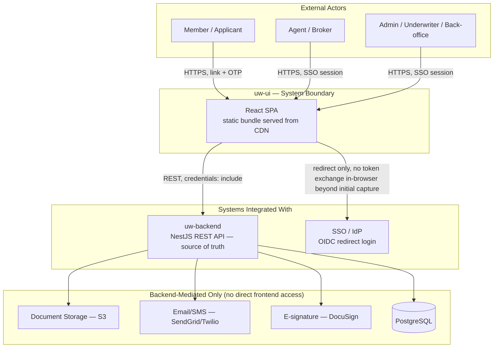
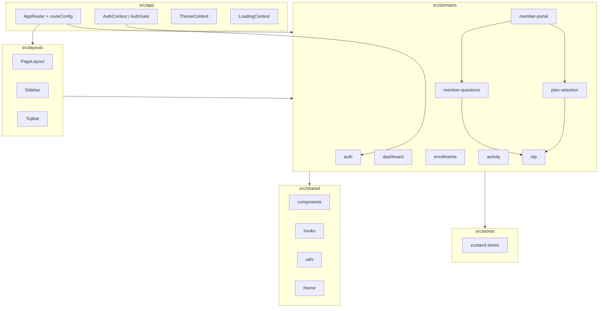
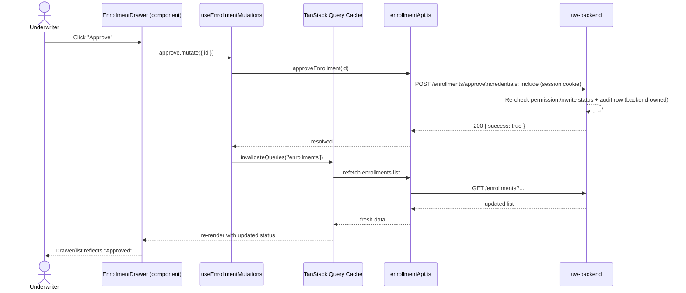

# Architecture Views — uw-ui (L713 Underwriting Frontend)

Companion diagram set to [architecture.md](./architecture.md). Four AAID views: System Map, Module Map, Data Flow, Dependency Graph.

---

## System Map

System boundary, external actors, and integrations.



**Notes:**
- uw-ui never talks to `DocStore`, `Notify`, `E-sign`, or the database directly — everything below `uw-backend` is out of the frontend's system boundary (ADR-001, ADR-007).
- Two distinct entry paths exist inside the same SPA boundary: SSO-gated (`AuthGate`) for staff, and link+OTP for members (ADR-005).

---

## Module Map

Internal modules and their responsibilities.



**Notes:**
- `otp` is a shared leaf module consumed by both member-facing flows (`plan-selection`, `member-questions`) — it owns no backend endpoints of its own.
- `member-portal` is an umbrella/entry module that routes into `plan-selection` and `member-questions`; it should stay thin (routing/token-resolution only).
- `shared` has zero inbound edges from `app`/`domains` in reverse — the arrow direction here is intentional and enforced by the anti-pattern rule in the Design Pattern Guide (no domain-to-domain deep imports; shared has no domain dependencies).

---

## Data Flow

How data moves through a representative request → process → persist cycle (enrollment approval, staff path).



**Notes:**
- The frontend never marks the enrollment "approved" optimistically before the backend confirms — status shown is always cache-invalidation-driven from a fresh `GET`, since this is a compliance-relevant state transition (consistent with ADR-006: the backend is the enforcement point).
- Member-facing flows (plan selection, questionnaire) follow the same shape but authenticate via link-token/`MemberSession` instead of the cookie, and typically don't need list invalidation (single-record flows).

---

## Dependency Graph

Libraries/services and where coupling concentrates.

```mermaid
graph LR
    subgraph Runtime["Core Runtime"]
        React[react / react-dom 18]
        Router2[react-router-dom 7]
    end

    subgraph ServerState["Server State"]
        RQ[@tanstack/react-query 5]
        RT[@tanstack/react-table 8]
    end

    subgraph ClientState["Client State"]
        Zustand[zustand 5]
    end

    subgraph Validation["Validation"]
        Zod[zod 4]
    end

    subgraph UI["UI / Presentation"]
        Bootstrap[bootstrap 5]
        Framer[framer-motion]
        Icons[react-icons]
        Toast[react-hot-toast]
        Charts[apexcharts / react-apexcharts]
    end

    subgraph DocGen["Document Generation"]
        Jspdf[jspdf / jspdf-autotable]
    end

    subgraph Build["Build / Tooling"]
        Vite[vite 5]
        TS[typescript 5.6]
        ESLint[eslint 9 + typescript-eslint]
    end

    Domains[src/domains/*] --> RQ
    Domains --> Zod
    Domains --> Router2
    Domains --> Zustand
    Domains --> RT
    Domains --> Charts
    Domains --> Jspdf
    App[src/app] --> React
    App --> Router2
    Shared[src/shared] --> Bootstrap
    Shared --> Framer
    Shared --> Icons
    Shared --> Toast
    Build --> App
    Build --> Domains
```

**Coupling hotspots:**
- **`@tanstack/react-query`** is the single heaviest point of coupling — nearly every domain hook depends on it for caching/invalidation. A version bump or config change (e.g., default `staleTime`, `QueryClient` setup in `app/providers`) has app-wide blast radius.
- **`enrollments` domain** is the largest consumer of libraries (react-table for grids, apexcharts indirectly via dashboard, jspdf for policy reports, notes/email-logs sub-APIs) — it's the natural place performance regressions or bundle-size growth will show up first (ADR on performance-sensitive operations: virtualization/pagination discipline matters most here).
- **`zod`** sits at the domain/type boundary in each module — a shared validation-schema convention (not yet centralized) is worth watching as domains multiply, to avoid subtly divergent validation rules for the same backend DTO shape.
