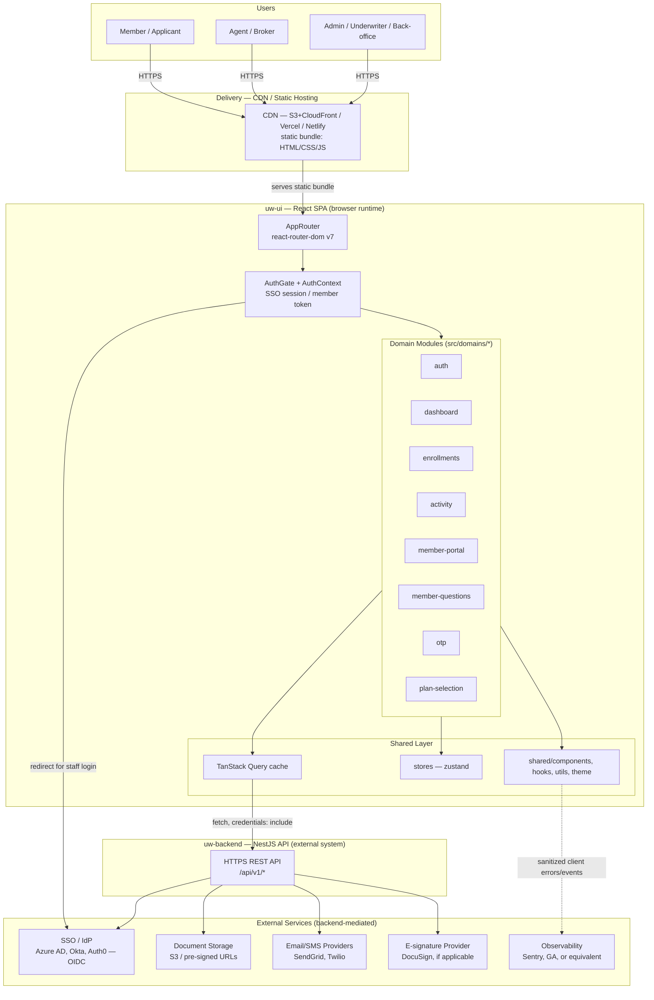
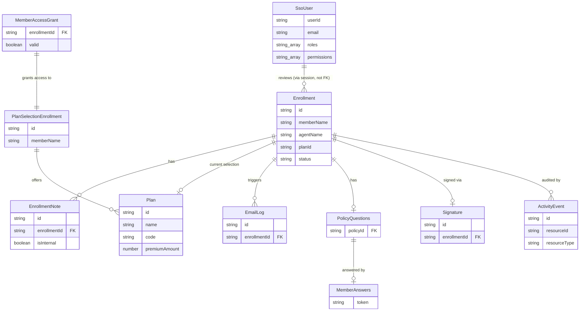

# Architecture Document — uw-ui (L713 Underwriting Frontend)

**Stack:** TypeScript · React 18 · Vite 5 · React Router 7 · TanStack Query 5 · TanStack Table 8 · Zustand 5 · Zod 4 · Bootstrap 5
**Pattern:** Clean Architecture (adapted for a client-side SPA)
**Backend of record:** uw-backend (NestJS API, PostgreSQL) — see [ADR-001](#adr-001-thin-client-spa-over-a-single-backend-of-record)
**Generated:** 2026-07-06

---

## Architecture Diagram



---

## Architecture Decision Records (ADRs)

### ADR-001: Thin-Client SPA Over a Single Backend of Record
- **Status:** Accepted
- **Context:** uw-ui serves three distinct user populations (members, agents/brokers, admin/back-office) across enrollment, plan selection, and account-management workflows. All business logic, RBAC enforcement, and audit trails already live in uw-backend (NestJS). The frontend has no database and no server-side runtime in production.
- **Decision:** uw-ui is a pure client-side SPA (React 18 + Vite, static build output) acting as a presentation layer over uw-backend's REST API (`VITE_API_BASE_URL_V1`). No business rules, authorization decisions, or sensitive data persistence are implemented client-side beyond what is needed for responsive UX (optimistic UI, client-side form validation as a first pass).
- **Consequences:** Simple, cacheable static deployment (CDN). Every authorization/business-rule check must be re-verified server-side — the frontend must never treat a client-side check as authoritative. Any UI-only convenience logic (e.g., disabling a button) is a UX aid, not a security control.

---

### ADR-002: Domain-Driven Module Structure as Clean Architecture Adaptation
- **Status:** Accepted (already in place — `src/domains/*`)
- **Context:** The app spans eight distinct workflows (auth, dashboard, enrollments, activity, member-portal, member-questions, otp, plan-selection) built and maintained by a small-to-medium team under enterprise delivery timelines. Business logic (enrollment status rules, plan-switch eligibility, OTP flows) must stay testable independent of React rendering.
- **Decision:** Organize by domain, not by technical layer, under `src/domains/<domain>/`, with each domain internally layered as `types/` (domain/entity types), `api/` (infrastructure gateway — `fetch` wrappers), `hooks/` (application/use-case layer — orchestrates TanStack Query + domain rules), `components/` and `pages/` (interface adapters — presentation), and optionally `providers/` (domain-scoped context, e.g. `EnrollmentsProvider`). Cross-cutting concerns live in `src/shared/` and `src/app/`.
- **Consequences:** Clear ownership boundaries per workflow; a domain can be extended or removed with minimal blast radius. Requires discipline to avoid domains reaching into each other's `api/` or `types/` directly — cross-domain needs should go through `shared/` or a domain's public `index.ts`. See the Design Pattern Guide below for enforcement rules.

---

### ADR-003: TanStack Query as the Server-State Layer
- **Status:** Accepted (already in place)
- **Context:** Admin/agent views involve data-heavy, filterable, paginated views (enrollments list, dashboard pipeline stats, email logs) that need caching, request de-duplication, background refetch, and cancellation (`AbortSignal`) — see e.g. `dashboardApi.ts`, `enrollmentApi.ts`.
- **Decision:** All server-derived data is fetched and cached via TanStack Query hooks (`useEnrollmentsQuery`, `useEmailLogsQuery`, etc.), never stored redundantly in Zustand or component state. Query keys are structured per domain + filter params to support targeted invalidation after mutations (`useEnrollmentMutations`).
- **Consequences:** Consistent loading/error/stale-data handling across the app; avoids manual cache bugs. Requires query-key discipline — an inconsistent key shape silently breaks cache invalidation after mutations.

---

### ADR-004: Zustand Reserved for Client-Only UI State
- **Status:** Accepted (already in place — `src/stores/enrollmentStore.ts`)
- **Context:** Some state is inherently client-side and cross-component (multi-step enrollment drawer state, active filters/selection, modal open/closed) and doesn't belong in the server-state cache.
- **Decision:** Zustand stores hold only ephemeral, client-only UI state (selected enrollment, drawer/modal visibility, in-progress multi-step form state before submission). Anything that originates from or is persisted to the backend goes through TanStack Query, never Zustand.
- **Consequences:** Prevents the two state systems from diverging or duplicating the same data. New contributors must know this convention — document it in domain READMEs or enforce via code review, since nothing prevents a Zustand store from accidentally caching server data.

---

### ADR-005: Dual-Mode Authentication — Cookie-Session SSO for Staff, Token-Link for Members
- **Status:** Accepted (already in place — `AuthContext.tsx`, `authApi.ts`)
- **Context:** Admin/agent/back-office users authenticate via enterprise SSO (OIDC-style redirect). Members/applicants reach enrollment-related flows (plan selection, medical questions) via emailed single-use links, without an SSO account.
- **Decision:** Staff auth: browser is redirected to the SSO IdP; the returned token is exchanged server-side for an HTTP-only session cookie (`POST /auth/session`, `credentials: 'include'`); the token itself is additionally kept in `sessionStorage` only to support a small number of legacy Bearer-auth endpoints (email content/forward), and is never used as the primary auth mechanism. Session resumption on reload uses `GET /auth/me` against the cookie. Member-portal routes (`/member-portal/*`, `/plan-selection/*`, `/member-questions` flows) bypass the SSO gate entirely and authenticate via a short-lived link token + OTP verification instead (`memberQuestionsApi.ts`: `/member/questions/access`, `/member/questions/send-otp`, `/member/questions/verify-otp`).
- **Consequences:** Two auth models must be kept mentally and architecturally separate — `AuthGate` explicitly special-cases `/member-portal` and must be updated if new member-facing route prefixes are added. The `sessionStorage` token is a residual sensitive-data-in-client-storage risk; new endpoints should be migrated to cookie auth rather than extending Bearer-token usage. See ADR-007 (security posture) for the storage constraint this creates tension with.

---

### ADR-006: Role/Permission-Gated UI as a UX Layer, Not a Security Boundary
- **Status:** Accepted (already in place — `usePermissions`, `hasRole`/`hasPermission` in `AuthContext`)
- **Context:** Admin, agent, and back-office roles need different dashboards, actions, and route access, but the authoritative RBAC decision is made by uw-backend (per ADR-005 of the backend architecture).
- **Decision:** `AuthContext` exposes `roles`/`permissions` from `/auth/me` and `hasRole`/`hasPermission`/`hasAnyRole`/`hasAllPermissions` helpers. Routes and UI elements (buttons, menu items, approve/reject actions) are conditionally rendered based on these, but every corresponding backend endpoint independently re-checks authorization. The frontend never assumes an action is safe to expose merely because the backend hasn't been asked yet.
- **Consequences:** Good UX (no dead-end screens for unauthorized users) without weakening security, since the backend is the actual enforcement point. Risk: a permission check present in the UI but missing on a new backend endpoint creates a false sense of security — cross-check new endpoints against the frontend gating during review.

---

### ADR-007: No Sensitive Data in Persistent Client Storage; Sanitized Client-Side Telemetry
- **Status:** Accepted
- **Context:** The system handles PII and insurance/enrollment data adjacent to health information, under SOC 2–aligned and HIPAA-adjacent expectations. The frontend has no server runtime to sanitize data before it reaches the browser, so discipline must be enforced in the client code itself.
- **Decision:** Auth is cookie-based (HTTP-only, `credentials: 'include'`) wherever possible (ADR-005); the one legacy `sessionStorage` token is scoped to session lifetime (not `localStorage`) and slated for removal as Bearer endpoints migrate to cookie auth. No PII/PHI-adjacent fields (SSN, DOB, medical answers) are written to `localStorage`, query-string state beyond short-lived single-use tokens, or third-party analytics/error-monitoring payloads. Any Sentry/GA-style integration must scrub request/response bodies and redact known-sensitive field names before reporting.
- **Consequences:** Slightly more server round-trips (no client-cached profile across sessions) in exchange for a materially smaller PII-exposure surface in the browser. Requires an explicit denylist/scrubber if/when an observability tool is introduced — this should be a lint or code-review gate, not tribal knowledge.

---

### ADR-008: Static Build, CDN Delivery, Build-Time Environment Injection
- **Status:** Accepted
- **Context:** No server-side rendering or dynamic frontend runtime is required; per-environment config (API base URL, SSO URLs) must vary across dev/QA/prod without shipping secrets into the bundle.
- **Decision:** `vite build` produces a static asset bundle deployed to a CDN-backed static host (S3+CloudFront, Vercel, or Netlify). Environment-specific values (`VITE_API_BASE_URL_V1`, `VITE_SSO_LOGIN_URL`, `VITE_SSO_LOGOUT_URL`, `VITE_SSO_SITE_KEY`, `VITE_SSO_USER_INFO_URL`) are injected at build time via Vite's `import.meta.env`, with a distinct build per environment (dev/QA/prod). CI/CD (GitHub Actions or equivalent) runs typecheck → lint → test → build → deploy on merge to environment-mapped branches.
- **Consequences:** Fast, cheap, highly cacheable delivery; no frontend server to patch or scale. Because config is baked in at build time, an environment misconfiguration requires a rebuild+redeploy, not a runtime flag flip — mitigate by validating required `VITE_*` vars fail loudly at startup (already done in `plan-selection`/`dashboard`/`member-questions` API modules via `if (!API_BASE_V1) throw ...`).

---

### ADR-009: Client-Side Validation as a First Pass, Not the Source of Truth
- **Status:** Accepted
- **Context:** Multi-step enrollment and medical-questionnaire forms need immediate feedback (Zod is already a dependency) to keep long forms usable, but the backend is the authoritative validator per ADR-004 (Clean Architecture layering) of the backend architecture.
- **Decision:** Use Zod schemas colocated with each domain's `types/` to validate form input client-side before submission, giving fast inline feedback. Every mutation still handles and surfaces backend validation errors (4xx responses) distinctly from client-side validation errors, since the backend may reject input the client-side schema allowed (e.g., business-rule checks the frontend doesn't know about).
- **Consequences:** Responsive multi-step forms with low perceived latency. Requires keeping client Zod schemas loosely in sync with backend DTOs — document drift as a known risk rather than attempting perfect duplication.

---

## Design Pattern Application Guide — Clean Architecture (Frontend Adaptation)

### Intent (in this project's context)
Keep enrollment/plan-selection/OTP business rules — validation, multi-step form state transitions, eligibility checks — testable and reasoned about independently of React rendering, routing, or the specific `fetch` calls used to reach uw-backend. A domain's core logic should not need a rendered DOM or a live network connection to be exercised by a test.

### Where it applies

| Layer | Location | Responsibility |
|---|---|---|
| Interface Adapters | `domains/*/pages/*.tsx`, `domains/*/components/*.tsx` | Render UI, translate user interaction into hook calls |
| Application / Use Cases | `domains/*/hooks/*.ts` | Orchestrate TanStack Query + domain rules; expose a use-case-shaped API to components |
| Domain | `domains/*/types/*.ts` (+ colocated Zod schemas) | Entities, value objects, form/state-machine shape — no React, no `fetch` |
| Infrastructure | `domains/*/api/*.ts` | `fetch` wrappers, request/response mapping, `API_BASE_V1` calls |
| Cross-cutting Infrastructure | `app/providers/*`, `stores/*` | Auth session, theme, loading state, client-only UI state |

### How to apply it

**Canonical folder structure per domain (already followed by `enrollments`, extend consistently to newer domains):**
```
src/domains/enrollments/
├── pages/
│   └── EnrollmentsPage.tsx          # Interface adapter — composes hooks + components
├── components/
│   └── EnrollmentDrawer.tsx         # Presentation only — props in, callbacks out
├── hooks/
│   ├── useEnrollmentsQuery.ts       # Use-case: list + filter enrollments
│   ├── useEnrollmentMutations.ts    # Use-case: approve / change-status / edit-plan
│   └── useEnrollmentFilters.ts      # Use-case: filter state derivation
├── providers/
│   └── EnrollmentsProvider.tsx      # Domain-scoped context, where a hook alone isn't enough
├── api/
│   └── enrollmentApi.ts             # Infrastructure — fetch(`${API_BASE_V1}/enrollments...`)
└── types/
    └── enrollment.ts                # Domain entities/DTOs — no fetch, no React imports
```

**Enforcement rules:**
- Components call hooks, never `domains/*/api/*` directly — a component should not import from an `api/` folder.
- `api/*.ts` files contain no business rules — they map HTTP requests/responses and throw typed errors (`ApiError`), nothing more.
- `types/*.ts` files import nothing from `react`, `react-router-dom`, or `api/` — pure data shapes and Zod schemas only.
- Cross-domain reuse goes through a domain's `index.ts` public export or `shared/`, never a direct deep import into another domain's internals (e.g., `plan-selection` must not import from `enrollments/api/*` directly).
- Server data lives only in TanStack Query's cache; Zustand stores hold only client-only UI state (ADR-004).
- Auth/permission checks used for conditional rendering come from `useAuth()`/`usePermissions()`, never re-derived ad hoc inside a component from raw JWT/user fields.

### Anti-patterns to avoid

| Anti-pattern | Why it's harmful |
|---|---|
| `fetch()` calls inside a page/component | Bypasses the `api/` gateway's error handling and typing; makes the endpoint impossible to find/reuse/mock |
| Business rules (e.g., "can this enrollment be approved?") inside JSX conditionals | Untestable without rendering; duplicates logic if the same rule is needed in two components |
| Storing server-fetched lists/records in Zustand | Creates a second source of truth that can drift from the TanStack Query cache after a mutation |
| A domain importing another domain's `api/` or `types/` internals directly | Hidden coupling; breaks the ability to change one domain's API shape without hunting cross-domain usages |
| Treating a `hasPermission()` UI check as sufficient authorization | The frontend has no enforcement power — every backend endpoint must independently authorize (ADR-006) |
| Writing PII/PHI-adjacent form values to `localStorage` for "autosave" convenience | Violates the no-persistent-client-storage-of-sensitive-data posture (ADR-007) |

---

## Component Breakdown

### 1. App Shell (`src/app/`)
**Single Responsibility:** Bootstrap the SPA — providers, routing, global styling — before any domain renders.
- **Inputs:** None (entry point)
- **Outputs:** Mounted React tree with routing, auth, theme, and loading context available to all domains
- **Dependencies:** `AuthContext`, `ThemeContext`, `LoadingContext`, `AppRouter`
- **Interface sketch:**
```typescript
function App(): JSX.Element; // wraps <AuthProvider><ThemeProvider><LoadingProvider><AuthGate><AppRouter/></AuthGate></...></...></...>
```

---

### 2. Router (`src/app/router/`)
**Single Responsibility:** Map URL paths to domain pages and enforce route-level access via `AuthGate`.
- **Inputs:** Browser URL/history
- **Outputs:** Rendered page component for the matched route
- **Dependencies:** `react-router-dom`, `routeConfig.ts`, `AuthContext`
- **Interface sketch:**
```typescript
const ROUTES = {
  DASHBOARD: '/', ENROLLMENTS: '/enrollments',
  ENROLLMENT_MEDICAL_DETAILS: '/enrollments/:policyId/medical-details',
  ACTIVITY: '/activity', MEMBER_PORTAL: '/member-portal',
  MEMBER_PORTAL_ACCESS: '/member-portal/access', MEMBER_PORTAL_OTP: '/member-portal/otp',
  MEMBER_PORTAL_PLAN_SELECTION: '/member-portal/plan-selection',
  OTP: '/plan-selection/verify', PLAN_SELECTION: '/plan-selection/select',
  PLAN_SELECTION_ADMIN: '/admin/plan-selection',
} as const;

function AppRouter(): JSX.Element;
function useAppNavigation(): { goTo: (route: AppRoute, params?: Record<string, string>) => void };
```

---

### 3. Auth Domain (`src/domains/auth/`, `src/app/providers/AuthContext.tsx`)
**Single Responsibility:** Establish and expose the current session (staff SSO or member link-token) and role/permission checks to the rest of the app.
- **Inputs:** SSO redirect token in URL, existing session cookie, or member link token
- **Outputs:** `{ status, user, roles, permissions }` via `useAuth()`
- **Dependencies:** `authApi.ts`, uw-backend `/auth/*`, SSO IdP
- **Interface sketch:**
```typescript
function useAuth(): {
  status: 'checking' | 'authenticated' | 'unauthenticated' | 'error';
  user: SsoUser | null;
  roles: string[];
  permissions: string[];
  hasRole(role: string): boolean;
  hasPermission(permission: string): boolean;
  hasAnyRole(...roles: string[]): boolean;
  hasAllPermissions(...permissions: string[]): boolean;
  logout(): void;
};
function AuthGate(props: { children: ReactNode }): JSX.Element;
```

---

### 4. Dashboard Domain (`src/domains/dashboard/`)
**Single Responsibility:** Present aggregate enrollment/pipeline metrics for admin/agent oversight.
- **Inputs:** Date range / filter params
- **Outputs:** Summary cards, pipeline stats
- **Dependencies:** `dashboardApi.ts` (`GET /dashboard`, `GET /dashboard/pipeline-stats`), `apexcharts`
- **Interface sketch:**
```typescript
function useDashboardSummary(signal?: AbortSignal): UseQueryResult<DashboardSummary>;
function usePipelineStats(filters: PipelineFilters): UseQueryResult<PipelineStats>;
```

---

### 5. Enrollments Domain (`src/domains/enrollments/`)
**Single Responsibility:** List, review, and action enrollment applications — the primary admin/underwriter workflow.
- **Inputs:** Filter/pagination params; approve/edit-plan/change-status commands; notes
- **Outputs:** Enrollment list/detail views, status history, notes, email logs, policy reports
- **Dependencies:** `enrollmentApi.ts`, `notesApi.ts`, `emailLogsApi.ts`, `l713PlansApi.ts`, `policyReportApi.ts`; uw-backend `/enrollments*`, `/email-logs*`
- **Interface sketch:**
```typescript
function useEnrollmentsQuery(filters: EnrollmentFilters): UseQueryResult<Paginated<Enrollment>>;
function useEnrollmentMutations(): {
  approve: UseMutationResult<void, ApiError, { id: string }>;
  editPlan: UseMutationResult<void, ApiError, { id: string; planId: string }>;
  changeStatus: UseMutationResult<void, ApiError, { id: string; status: EnrollmentStatus; reason?: string }>;
};
function useNotesQuery(policyId: string): UseQueryResult<EnrollmentNote[]>;
function useEmailLogsQuery(filters: EmailLogFilters): UseQueryResult<Paginated<EmailLog>>;
```

---

### 6. Plan Selection Domain (`src/domains/plan-selection/`)
**Single Responsibility:** Drive member-facing and admin-facing plan selection/signature flows.
- **Inputs:** Enrollment id/link token, selected plan, signature payload
- **Outputs:** Plan selection state, submitted signature confirmation
- **Dependencies:** `planSelectionApi.ts` (`GET /plan-selection/enrollment`, `POST /plan-selection/submit`, `POST /member/signature/plan-selection[/submit]`), `adminPlanSelectionApi.ts` (`GET /plan-selection/admin/enrollment`)
- **Interface sketch:**
```typescript
function usePlanSelectionEnrollment(id: string): UseQueryResult<PlanSelectionEnrollment>;
function useSubmitPlanSelection(): UseMutationResult<void, ApiError, PlanSelectionSubmission>;
function useSubmitPlanSelectionSignature(): UseMutationResult<void, ApiError, SignaturePayload>;
```

---

### 7. Member Questions Domain (`src/domains/member-questions/`)
**Single Responsibility:** Serve the medical/eligibility questionnaire to members via link + OTP, and expose admin read access to submitted answers.
- **Inputs:** Link token, OTP code, question answers, decline-by-link action
- **Outputs:** Access grant, submitted answers, admin view of a policy's questions
- **Dependencies:** `memberQuestionsApi.ts` (`/member/questions/access`, `/member/questions/send-otp`, `/member/questions/verify-otp`, `/member/questions/answers`, `/member/signature/decline-by-link`, `/enrollments/:policyId/questions`)
- **Interface sketch:**
```typescript
function useMemberAccess(token: string): UseQueryResult<MemberAccessGrant>;
function useSendOtp(): UseMutationResult<void, ApiError, { token: string }>;
function useVerifyOtp(): UseMutationResult<MemberSession, ApiError, { token: string; code: string }>;
function useSubmitAnswers(): UseMutationResult<void, ApiError, MemberAnswers>;
function usePolicyQuestions(policyId: string): UseQueryResult<PolicyQuestions>; // admin view
```

---

### 8. OTP Domain (`src/domains/otp/`)
**Single Responsibility:** Reusable one-time-passcode entry/verification UI shared by member-facing flows.
- **Inputs:** Delivery target (email/phone, implicit via link token), user-entered code
- **Outputs:** Verified/failed state, resend action
- **Dependencies:** Backing OTP endpoints owned by the domain that invoked it (e.g., `member-questions`, `plan-selection`)
- **Interface sketch:**
```typescript
function useOtpVerification(opts: { onVerify: (code: string) => Promise<void>; onResend: () => Promise<void> }): {
  submit(code: string): Promise<void>;
  resend(): Promise<void>;
  status: 'idle' | 'pending' | 'verified' | 'error';
};
```

---

### 9. Member Portal Domain (`src/domains/member-portal/`)
**Single Responsibility:** Umbrella entry surface for members reaching enrollment/plan-selection flows outside the SSO gate.
- **Inputs:** Portal link/token from email
- **Outputs:** Routed access into plan-selection/member-questions sub-flows
- **Dependencies:** `AuthGate`'s `/member-portal` bypass, `plan-selection` and `member-questions` domains
- **Interface sketch:**
```typescript
function MemberPortalAccessPage(): JSX.Element; // resolves token, redirects into the correct sub-flow
```

---

### 10. Activity Domain (`src/domains/activity/`)
**Single Responsibility:** Present an audit/activity feed of actions taken across enrollments for admin oversight.
- **Inputs:** Filter params (actor, resource, date range)
- **Outputs:** Chronological activity list, correlated to backend `data_access_log` entries
- **Dependencies:** Backend activity/audit-read endpoint (mediated — no direct DB access per the backend's ADR-006)
- **Interface sketch:**
```typescript
function useActivityFeed(filters: ActivityFilters): UseQueryResult<Paginated<ActivityEvent>>;
```

---

### 11. Shared Layer (`src/shared/`)
**Single Responsibility:** House cross-domain building blocks — reusable components, hooks, formatting utilities, theming — with zero domain-specific business logic.
- **Inputs:** Domain-agnostic props/config
- **Outputs:** Reusable UI primitives, formatters, generic hooks
- **Dependencies:** None on any `domains/*` module (one-directional: domains depend on shared, never the reverse)
- **Interface sketch:**
```typescript
function useCurrentUser(): SsoUser | null;         // thin wrapper over useAuth()
function usePermissions(): { hasPermission: (p: string) => boolean; hasRole: (r: string) => boolean };
function useDarkMode(): [boolean, () => void];
function formatCurrency(amount: number): string;
function formatDate(value: string | Date): string;
```

---

### 12. Client-State Stores (`src/stores/`)
**Single Responsibility:** Hold ephemeral, client-only UI state not owned by TanStack Query (ADR-004).
- **Inputs:** UI interaction events (open drawer, select row, advance step)
- **Outputs:** Reactive UI state consumed by components
- **Dependencies:** `zustand`
- **Interface sketch:**
```typescript
interface EnrollmentStoreState {
  selectedEnrollmentId: string | null;
  isDrawerOpen: boolean;
  selectEnrollment(id: string): void;
  closeDrawer(): void;
}
const useEnrollmentStore: UseBoundStore<StoreApi<EnrollmentStoreState>>;
```

---

### 13. HTTP Gateway Layer (`domains/*/api/*.ts`)
**Single Responsibility:** Translate domain use-cases into `fetch` calls against uw-backend, and backend responses/errors into typed domain results.
- **Inputs:** Domain-shaped request params
- **Outputs:** Typed responses or a thrown `ApiError`
- **Dependencies:** `fetch`, `VITE_API_BASE_URL_V1`, cookie session (`credentials: 'include'`)
- **Interface sketch:**
```typescript
class ApiError extends Error { constructor(public readonly status: number, message: string); }
// Pattern repeated per domain, e.g.:
async function fetchEnrollments(filters: EnrollmentFilters, signal?: AbortSignal): Promise<Paginated<Enrollment>>;
async function approveEnrollment(id: string): Promise<void>;
```

---

## API Contract Sketch (Consumed — uw-backend is the provider)

uw-ui does not define its own API; it consumes uw-backend's REST API. This section documents the contract **as consumed today**, grounded in the actual `domains/*/api/*.ts` call sites, so frontend and backend changes can be cross-checked against each other.

### Auth (`src/domains/auth/api/authApi.ts`)

| Method | Path | Summary | Request | Response | Auth |
|---|---|---|---|---|---|
| POST | `/auth/session` | Exchange SSO redirect token for a session cookie | `{ access_token: string }` | `AuthMeResponse` (sets HTTP-only cookie) | SSO token (one-time) |
| POST | `/auth/logout` | Destroy the current session | — | `204/200` | Session cookie |
| GET | `/auth/me` | Resume session on reload; returns identity + roles/permissions | — | `{ userId; email; firstName; lastName; roles: string[]; permissions: string[] }` | Session cookie |

### Dashboard (`src/domains/dashboard/api/dashboardApi.ts`)

| Method | Path | Summary | Request | Response | Auth |
|---|---|---|---|---|---|
| GET | `/dashboard` | Aggregate summary cards | — | `DashboardSummary` | Session cookie |
| GET | `/dashboard/pipeline-stats` | Enrollment pipeline breakdown | Query: filter params | `PipelineStats` | Session cookie |

### Enrollments (`src/domains/enrollments/api/*.ts`)

| Method | Path | Summary | Request | Response | Auth |
|---|---|---|---|---|---|
| GET | `/enrollments` | List/filter enrollments | Query: filters + pagination | `{ data: Enrollment[]; total: number }` | Session cookie |
| POST | `/enrollments/approve` | Approve an enrollment | `{ id: string }` | `{ success: boolean }` | Session cookie + permission |
| POST | `/enrollments/edit-plan` | Change selected plan on an enrollment | `{ id: string; planId: string }` | `{ success: boolean }` | Session cookie + permission |
| POST | `/enrollments/change-status` | Transition enrollment status | `{ id: string; status: string; reason?: string }` | `{ success: boolean }` | Session cookie + permission |
| GET / POST | `/enrollments/:policyId/notes` | List / add notes on an enrollment | Body (POST): `{ content: string; isInternal?: boolean }` | `EnrollmentNote[]` / `EnrollmentNote` | Session cookie |
| GET | `/enrollments/:policyId/questions` | Admin view of submitted medical questions | — | `PolicyQuestions` | Session cookie |
| GET | `/enrollments/l713-plans` | List selectable plans for an enrollment | Query params | `Plan[]` | Session cookie |
| GET | `/enrollments/policy-report` | Generate/export policy report data | Query params | Report payload (consumed by `jspdf`) | Session cookie |
| GET | `/email-logs` | List email logs | Query params | `{ data: EmailLog[]; total: number }` | Session cookie |
| GET | `/email-logs/:id/content` (base64 id) | Fetch a single email's content | — | `EmailLogContent` | Session cookie |
| POST | `/email-logs/:id/forward` | Forward a logged email | `{ to: string }` | `{ success: boolean }` | Session cookie |
| POST | `/email-logs/questionnaire-reminder` | Trigger a reminder email | `{ enrollmentId: string }` | `{ success: boolean }` | Session cookie |

### Plan Selection (`src/domains/plan-selection/api/*.ts`)

| Method | Path | Summary | Request | Response | Auth |
|---|---|---|---|---|---|
| GET | `/plan-selection/enrollment?id=` | Fetch enrollment context for plan selection | Query: `id` | `PlanSelectionEnrollment` | Member link/token |
| POST | `/plan-selection/submit` | Submit selected plan | `PlanSelectionSubmission` | `{ success: boolean }` | Member link/token |
| POST | `/member/signature/plan-selection` | Capture plan-selection signature | `SignaturePayload` | `Signature` | Member link/token |
| POST | `/member/signature/plan-selection/submit` | Finalize signed plan selection | `{ enrollmentId: string }` | `{ success: boolean }` | Member link/token |
| GET | `/plan-selection/admin/enrollment?id=` | Admin view of a plan-selection enrollment | Query: `id` | `PlanSelectionEnrollment` | Session cookie |

### Member Questions (`src/domains/member-questions/api/memberQuestionsApi.ts`)

| Method | Path | Summary | Request | Response | Auth |
|---|---|---|---|---|---|
| GET | `/member/questions/access?token=` | Validate member link token | Query: `token` | `MemberAccessGrant` | Link token |
| POST | `/member/questions/send-otp` | Send OTP to member's contact | `{ token: string }` | `{ success: boolean }` | Link token |
| POST | `/member/questions/verify-otp` | Verify OTP, establish member session | `{ token: string; code: string }` | `MemberSession` | Link token |
| POST | `/member/questions/answers` | Submit questionnaire answers | `MemberAnswers` | `{ success: boolean }` | Member session |
| POST | `/member/signature/decline-by-link` | Decline enrollment via emailed link | `{ token: string; reason?: string }` | `{ success: boolean }` | Link token |

---

## Data Model Overview (Frontend Domain/View Models)

uw-ui holds no persistent data store; these are the client-side TypeScript shapes each domain works with, sourced from — and validated against — uw-backend responses. Access pattern notes describe how each is fetched/cached (TanStack Query key shape), not database access.

### SsoUser / AuthMeResponse
**Purpose:** Represents the authenticated staff principal and their access grants for the session's lifetime.
- Fields: `userId: string`, `email: string`, `firstName: string`, `lastName: string`, `roles: string[]`, `permissions: string[]`
- Relationships: referenced by every mutation as the implicit actor (backend attributes writes via session, not a client-supplied field)
- Access pattern: fetched once via `GET /auth/me` on load/reload; held in `AuthContext`, not TanStack Query (it's session-scoped singleton state, not a list/detail resource)

### Enrollment
**Purpose:** The core work item admin/underwriter users review, approve, and track — mirrors backend's `l713_enrollments`.
- Fields (client view): `id: string`, `memberName: string`, `agentName: string`, `planId: string`, `status: EnrollmentStatus`, `submittedAt: string`, `reviewedAt: string | null`
- Relationships: has many `EnrollmentNote`, one current `Plan` selection, many `EmailLog` entries, one `PolicyQuestions` submission
- Access pattern: `useEnrollmentsQuery(filters)` → query key `['enrollments', filters]`, paginated list with server-side filtering; `useEnrollmentMutations()` invalidates `['enrollments']` and `['enrollments', id]` on success

### EnrollmentNote
**Purpose:** Internal/external annotations on an enrollment.
- Fields: `id: string`, `content: string`, `isInternal: boolean`, `authorId: string`, `createdAt: string`
- Relationships: belongs to one `Enrollment`
- Access pattern: `useNotesQuery(policyId)` → query key `['enrollment-notes', policyId]`

### Plan
**Purpose:** Selectable insurance plan shown during plan-selection and enrollment review.
- Fields: `id: string`, `name: string`, `code: string`, `premiumAmount: number`, `isActive: boolean`
- Relationships: referenced by `Enrollment.planId`, listed via `l713-plans` endpoint
- Access pattern: `useL713Plans(enrollmentId)` → query key `['l713-plans', enrollmentId]`; long `staleTime` since plan catalogs change infrequently

### PlanSelectionEnrollment
**Purpose:** Member-facing view of an enrollment during the plan-selection flow (subset of admin `Enrollment` fields, no internal notes).
- Fields: `id: string`, `memberName: string`, `availablePlans: Plan[]`, `currentSelection: string | null`
- Access pattern: `usePlanSelectionEnrollment(id)` → query key `['plan-selection', id]`, member-token authenticated

### MemberAccessGrant / MemberSession
**Purpose:** Represents a member's validated link-token access and, after OTP verification, their short-lived session for submitting the questionnaire.
- Fields: `MemberAccessGrant { valid: boolean; enrollmentId: string; contactMasked: string }`; `MemberSession { sessionToken: string; expiresAt: string }`
- Access pattern: not cached long-term — `useMemberAccess(token)` runs once per link visit; `MemberSession` held in memory/component state for the duration of the questionnaire flow only (not `localStorage`, per ADR-007)

### PolicyQuestions / MemberAnswers
**Purpose:** The medical/eligibility questionnaire and its submitted answers for a given enrollment.
- Fields: `PolicyQuestions { policyId: string; questions: Question[] }`; `MemberAnswers { token: string; answers: Answer[] }`
- Relationships: belongs to one `Enrollment`
- Access pattern: `usePolicyQuestions(policyId)` (admin, query key `['policy-questions', policyId]`); submission via `useSubmitAnswers()` mutation (member flow, no long-lived cache)

### Signature
**Purpose:** Captured e-signature confirming plan selection or decline.
- Fields: `id: string`, `signedBy: string`, `signedAt: string`, `signatureData: string`
- Relationships: belongs to one `Enrollment`
- Access pattern: write-only from the frontend's perspective (`useSubmitPlanSelectionSignature()`); never re-read/re-rendered client-side beyond a confirmation state

### EmailLog
**Purpose:** Record of outbound emails related to an enrollment, viewable/forwardable by admin staff.
- Fields: `id: string` (base64-encoded for URL-safety), `recipient: string`, `subject: string`, `status: string`, `sentAt: string`
- Relationships: belongs to one `Enrollment`
- Access pattern: `useEmailLogsQuery(filters)` → query key `['email-logs', filters]`, paginated

### DashboardSummary / PipelineStats
**Purpose:** Aggregate metrics for the admin/agent landing dashboard.
- Fields: `DashboardSummary { totalEnrollments: number; pendingReview: number; approvedThisMonth: number; ... }`; `PipelineStats { byStatus: Record<EnrollmentStatus, number>; trend: TrendPoint[] }`
- Access pattern: `useDashboardSummary()` → query key `['dashboard-summary']`; `usePipelineStats(filters)` → query key `['pipeline-stats', filters]`; both use `AbortSignal` to cancel stale requests on filter change

### ActivityEvent
**Purpose:** Client-side view of backend's append-only `data_access_log`, surfaced for admin oversight.
- Fields: `id: string`, `actor: string`, `action: string`, `resourceType: string`, `resourceId: string`, `occurredAt: string`
- Access pattern: `useActivityFeed(filters)` → query key `['activity', filters]`, paginated, read-only

### EnrollmentStore (client-only, not backend-derived)
**Purpose:** Ephemeral UI state — which enrollment's drawer is open, current multi-step form position — never sent to or received from the backend directly (only its *results*, like a submitted mutation, are).
- Fields: `selectedEnrollmentId: string | null`, `isDrawerOpen: boolean`
- Access pattern: Zustand store, in-memory only, reset on navigation away

---

### Domain / Data-Flow Diagram


