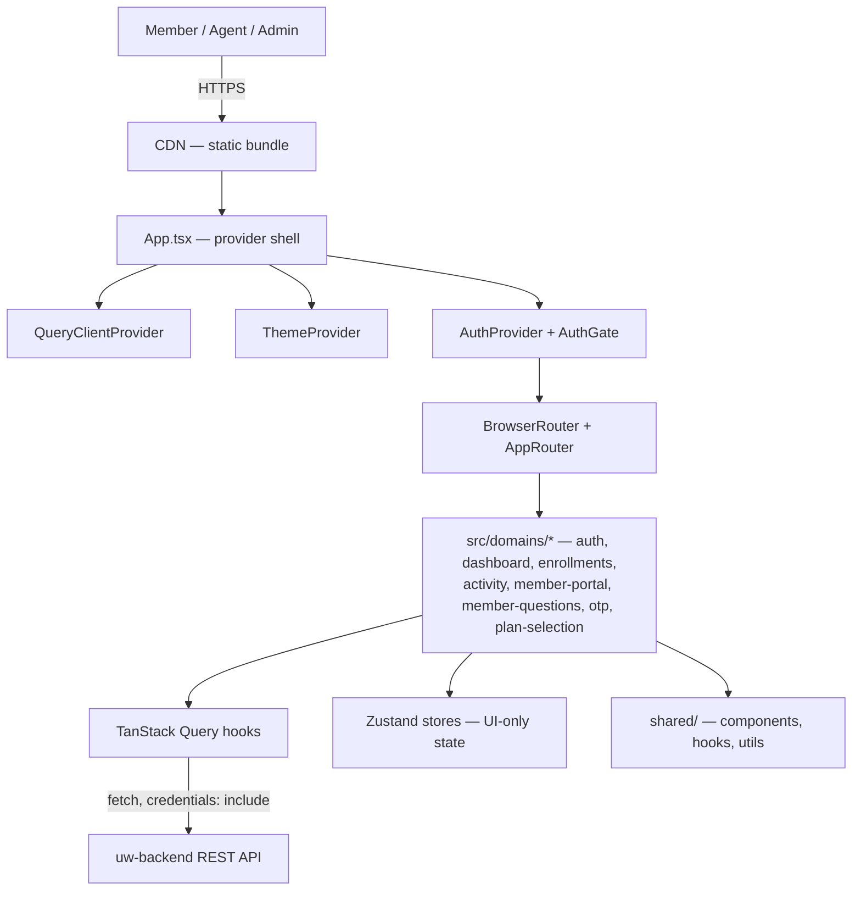

# Project Overview — uw-ui (L713 Underwriting Frontend)

Internal "how this actually works" reference for engineers joining the team. Not marketing copy — see [README.md](../../README.md) for that. Pairs with [architecture.md](./architecture/architecture.md) and [arch-views.md](./architecture/arch-views.md), which this document assumes and doesn't repeat.

---

## 1. What this system does

uw-ui is a React + TypeScript single-page application for individual health insurance enrollment and underwriting. Three user populations use it: **members/applicants** completing enrollment and plan-selection via emailed links, **agents/brokers** managing enrollments on behalf of clients, and **admin/underwriter/back-office staff** reviewing, approving, and tracking cases through an SSO-gated dashboard. It renders UI and drives workflows over the `uw-backend` NestJS API — it holds no database and makes no authorization decisions of its own. It does **not** store PII persistently in the browser, does not talk to SSO/document-storage/notification/e-signature providers directly (all backend-mediated), and does not run a server in production (static build, CDN-served).

---

## 2. Key design decisions

These summarize the ADRs in [architecture.md](./architecture/architecture.md#architecture-decision-records-adrs) — read that document for full context/consequences.

| Decision | What / Why |
|---|---|
| Thin-client SPA ([ADR-001](./architecture/architecture.md#adr-001-thin-client-spa-over-a-single-backend-of-record)) | No business logic or auth decisions client-side; every check is re-verified by `uw-backend`. |
| Domain-driven folders ([ADR-002](./architecture/architecture.md#adr-002-domain-driven-module-structure-as-clean-architecture-adaptation)) | `src/domains/<domain>/{api,hooks,types,components,pages}` — chosen over technical-layer folders so each workflow (enrollments, plan-selection, etc.) can evolve independently. |
| TanStack Query owns server state ([ADR-003](./architecture/architecture.md#adr-003-tanstack-query-as-the-server-state-layer)) | Caching, dedup, and invalidation for anything that comes from the backend — never duplicated into Zustand. |
| Zustand is client-UI-state only ([ADR-004](./architecture/architecture.md#adr-004-zustand-reserved-for-client-only-ui-state)) | Drawer/modal state, in-progress form position — nothing that originated from the backend. |
| Dual auth model ([ADR-005](./architecture/architecture.md#adr-005-dual-mode-authentication--cookie-session-sso-for-staff-token-link-for-members)) | Staff use SSO → session cookie; members use a link token + OTP. These are architecturally separate paths inside one SPA, not two apps. |
| UI-level RBAC is UX, not security ([ADR-006](./architecture/architecture.md#adr-006-rolepermission-gated-ui-as-a-ux-layer-not-a-security-boundary)) | `hasRole`/`hasPermission` hide/show UI; the backend independently authorizes every write. |
| No sensitive data in persistent storage ([ADR-007](./architecture/architecture.md#adr-007-no-sensitive-data-in-persistent-client-storage-sanitized-client-side-telemetry)) | Cookie-based session preferred over `localStorage`; one legacy `sessionStorage` token is a known, scoped exception (see §6). |
| Static build + CDN delivery ([ADR-008](./architecture/architecture.md#adr-008-static-build-cdn-delivery-build-time-environment-injection)) | `vite build` output served from a CDN; per-environment config baked in at build time via `VITE_*` vars. |
| Client-side validation is a first pass ([ADR-009](./architecture/architecture.md#adr-009-client-side-validation-as-a-first-pass-not-the-source-of-truth)) | Zod schemas give fast form feedback; backend validation errors are still handled and surfaced distinctly. |

---

## 3. How the pieces connect

**Walkthrough:** Every request enters through the CDN as a static asset; there's no server-side routing. `App.tsx` nests providers in a specific order — `LoadingProvider` → `QueryClientProvider` → `ThemeProvider` → `AuthProvider` → `BrowserRouter` → `AuthGate` → `AppRouter` (see `src/app/App.tsx`). `AuthGate` is the traffic cop: it lets `/member-portal/*` routes through unconditionally (member link-token flow) and blocks everything else until `AuthContext` resolves a staff session (SSO redirect or cookie resumption). Once past the gate, `AppRouter` renders a domain's page, which composes TanStack Query hooks (server state) and Zustand stores (client-only UI state) from that domain's `api/`, `hooks/`, and `types/` files. Cross-cutting UI primitives come from `shared/`, which depends on nothing in `domains/` or `app/` — that dependency direction is load-bearing (see Design Pattern Guide anti-patterns in architecture.md).

---

## 4. Module / layer guide

| Path | Single responsibility | Goes in | Doesn't go in |
|---|---|---|---|
| `src/app/` | Bootstrap: providers, router, global styles | `App.tsx`, `providers/*`, `router/*` | Domain-specific business logic |
| `src/domains/<name>/api/` | HTTP gateway to `uw-backend` for that domain | `fetch` calls, `ApiError` mapping | Business rules, React imports |
| `src/domains/<name>/hooks/` | Application/use-case layer | TanStack Query hooks wrapping `api/`, orchestration | Direct `fetch` calls, JSX |
| `src/domains/<name>/types/` | Domain entities/DTOs + Zod schemas | Pure TS types and validators | `react`, `react-router-dom`, `api/` imports |
| `src/domains/<name>/components/` | Presentation, domain-specific | Props-in/callbacks-out components | Data fetching |
| `src/domains/<name>/pages/` | Route-level composition | Assembles hooks + components for a route | Reusable primitives (belongs in `shared/`) |
| `src/domains/<name>/providers/` | Domain-scoped context (where a hook alone isn't enough) | e.g. `EnrollmentsProvider` | App-wide concerns (belongs in `app/providers/`) |
| `src/shared/` | Cross-domain, domain-agnostic building blocks | Reusable components, hooks, utils, theme | Anything importing from `domains/*` |
| `src/stores/` | Ephemeral, client-only UI state | Zustand stores (drawer open, selected row) | Server-fetched data (belongs in TanStack Query cache) |
| `src/layouts/` | Page chrome | `PageLayout`, `Sidebar`, `Topbar` | Route-specific business logic |

---

## 5. Critical paths

### 5.1 Staff login (SSO)
1. Unauthenticated staff user hits any non-`/member-portal` route → `AuthGate` (`src/app/providers/AuthContext.tsx`) sees `status: 'checking'`, then `'unauthenticated'`.
2. `AuthProvider`'s `checkAuth()` effect runs: no session cookie and no `?token=` in the URL → `redirectToSsoLogin()` sends the browser to the IdP (`authApi.ts`).
3. IdP redirects back with a token in the URL (`getTokenFromUrl()`).
4. `createSession(token)` → `POST /auth/session` exchanges it for an HTTP-only session cookie; the raw token is additionally kept in `sessionStorage['uw_access_token']` for a small set of legacy Bearer endpoints, then stripped from the URL (`clearTokenFromUrl()`).
5. `AuthContext` sets `user`, `roles`, `permissions`, `status: 'authenticated'` → `AuthGate` renders `AppRouter`.
6. On reload, step 2 instead finds no URL token and calls `fetchAuthMe()` (`GET /auth/me`) to resume the session from the cookie.

### 5.2 Admin approves an enrollment
1. Underwriter opens `/enrollments`, `EnrollmentsPage.tsx` renders via `useEnrollmentsQuery(filters)` (`domains/enrollments/hooks/useEnrollmentsQuery.ts`) → `GET /enrollments?...`.
2. Underwriter opens a case in `EnrollmentDrawer.tsx`, clicks Approve → `useEnrollmentMutations().approve.mutate({ id })` (`domains/enrollments/hooks/useEnrollmentMutations.ts`).
3. `enrollmentApi.ts` calls `POST /enrollments/approve` with the session cookie; `uw-backend` re-checks the `enrollments:approve` permission and writes the status + audit row — the frontend does not assume this succeeds just because the button was visible.
4. On success, the mutation invalidates the `['enrollments']` query key; TanStack Query refetches the list, and the drawer/list re-render with the new status. No optimistic update is applied for this compliance-relevant transition (see arch-views.md Data Flow diagram).

### 5.3 Member completes the medical questionnaire
1. Member clicks an emailed link containing a token → lands on a `member-questions` or `member-portal` route, bypassing `AuthGate`'s SSO check entirely (path starts with `/member-portal`).
2. `useMemberAccess(token)` → `GET /member/questions/access?token=` validates the link and returns a `MemberAccessGrant`.
3. Member requests and enters an OTP (shared `otp` domain component) → `send-otp` / `verify-otp` (`memberQuestionsApi.ts`) → establishes a short-lived `MemberSession` held in memory, not `localStorage`.
4. Member submits answers → `useSubmitAnswers()` → `POST /member/questions/answers`. No long-lived client cache of the answers is kept once submitted.

---

## 6. Non-obvious things

- **Two authentication systems coexist in one SPA.** SSO/cookie auth for staff and link+OTP for members are not interchangeable, and `AuthGate` special-cases the `/member-portal` prefix to skip the SSO check entirely. Adding a new member-facing route outside that prefix will silently force it through the SSO gate — check `AuthGate` in `src/app/providers/AuthContext.tsx` before adding member routes.
- **A legacy Bearer token lives in `sessionStorage`, against the project's general no-persistent-sensitive-storage posture.** It's kept only because a handful of endpoints (email content/forward) still expect `Authorization: Bearer`. New endpoints should use the cookie session instead of extending this pattern (ADR-005/ADR-007 in architecture.md).
- **`VITE_API_BASE_URL_V1` is required by almost every API module but is missing from `.env.example`.** Most modules (`plan-selection`, `dashboard`, `member-questions`, etc.) throw at import time if it's unset — a new developer copying `.env.example` verbatim will get a hard failure, not a graceful fallback. (`authApi.ts` is the one exception — it falls back to `/api` if unset, which is inconsistent with the rest.)
- **`VITE_ADMIN_URL` is set in `.env` but not referenced anywhere in `src/`.** Either dead configuration or a var for a not-yet-implemented redirect — don't assume it's wired up.
- **The checked-in `README.md` describes a folder structure that no longer exists** (`components/`, `features/`, `context/`, `data/` instead of the current `domains/`, `app/`, `stores/`, `shared/`). Don't trust it for onboarding until it's updated — trust `src/` itself and this document.
- **Server state and client state are deliberately split across two libraries** (TanStack Query vs. Zustand) with no technical barrier preventing someone from caching server data in a Zustand store. This is a convention, not an enforced rule — watch for it in review (ADR-004).
- **UI-level `hasPermission()`/`hasRole()` checks are UX only.** A missing permission check on a new backend endpoint is a real security gap even if the corresponding UI button is correctly hidden — the frontend gate provides no enforcement (ADR-006).
- **The provider nesting order in `App.tsx` matters.** `LoadingProvider` wraps everything (so `GlobalLoader` can render during the earliest auth-checking state), and `AuthGate` sits inside `BrowserRouter` but wraps `AppRouter` — moving `AuthGate` outside `BrowserRouter` would break `useLocation()`-based route checks it relies on (the `/member-portal` bypass).
- **Enrollment approval/status changes never apply an optimistic UI update** — the UI waits for a fresh `GET /enrollments` refetch after a successful mutation, unlike typical TanStack Query optimistic-update patterns. This is intentional for a compliance-relevant state transition, not an oversight — don't "fix" it by adding optimistic updates without checking with the team first.

---

## 7. Onboarding checklist

1. Read this document, then [architecture.md](./architecture/architecture.md) in full (ADRs + Design Pattern Guide + Component Breakdown).
2. Skim [arch-views.md](./architecture/arch-views.md) for the System Map and Data Flow diagrams — they show the request lifecycle visually.
3. Copy `.env.example` to `.env`, then **also** add `VITE_API_BASE_URL_V1` (pointing at your local/QA `uw-backend`) — it's required but not in the example file (see §6).
4. Run `npm install && npm run dev`, confirm the app loads at `http://localhost:5173` and that staff SSO login round-trips against your configured `VITE_SSO_*` values.
5. Walk through §5's three critical paths in the running app: staff login, approving a test enrollment, and (if you have a test link) the member questionnaire flow.
6. Read one full domain end-to-end as a template — `src/domains/enrollments/` is the most complete example of the `api/ → hooks/ → components/ → pages/` layering described in §4.
7. Before your first PR, read the Design Pattern Guide's "Anti-patterns to avoid" table in architecture.md — most review feedback for new contributors traces back to one of those five patterns.
